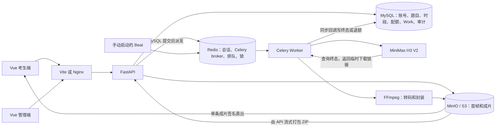

# 当前架构

审计基线为本地 HEAD `6096b60`。源码 tree 与用户 Fork `main` 的 `d7c5ec4` 一致。

1. **登录与管理。** 考生和管理员用不同的 Redis SID 与 HttpOnly Cookie。管理员操作 MySQL 中的考生、题目、配额、时段和引擎。初始考生密码使用 Fernet 加密，认证密码使用 bcrypt。[会话](../../backend/app/core/sessions.py#L49) · [管理员管理入口](../../backend/app/admin/candidates.py)
2. **上传。** API 读入 multipart 图片，校验文件大小、魔数和审核，上传 S3 后写入 `draft`。浏览器压缩为创建草稿前的辅助处理。[草稿](../../backend/app/services/works.py#L108)
3. **提交。** 锁定本人的 Work，检查状态、时段与配额。MySQL 事务做条件扣额和置为 `queued`，随后签首帧链接、写 Redis 排队标记并派发 Celery。同步失败回调在 MySQL 事务中处理 Work、配额和审计。[提交](../../backend/app/services/works.py#L179) · [退额](../../backend/app/services/handoff_sync.py#L195)
4. **生成。** Worker 用 Redis 锁和槽控制并发，再从数据库读 Work、考生和引擎。裁剪首帧后 POST MiniMax；上游 ID 先存 Redis 再写入 MySQL。Worker 轮询并转码、上传，再调用业务回调。[任务入口](../../backend/worker/tasks.py#L59) · [流水线](../../backend/worker/pipeline.py#L140)
5. **状态与下载。** 当前状态为 `draft / queued / running / succeeded / failed`。工作台用固定间隔轮询，恢复一项进行中任务。单条下载执行归属、状态和对象存在检查，返回签名链接。ZIP 经 FastAPI 流式传输。[工作台](../../frontend/src/views/candidate/WorkspaceView.vue#L406) · [下载](../../backend/app/api/works.py#L225)

MySQL 是配额、Work、历史终态和审计的权威记录。Redis 当前也承载无法全部从数据库重建的请求标记和执行锁。对象存储承载实际内容，数据库的成片键只能证明曾写入关联。

现有 Compose 启动 MySQL、Redis、MinIO 和 Nginx。Windows PowerShell 启动宿主机 API，Worker 与 Beat 需要另外启动。目标是 Ubuntu 24.04 单机 Compose，API、Dispatcher、Worker 和 Beat 进入受控服务拓扑。宿主机、磁盘和可用区故障仍需依赖异地备份与恢复方案。[Compose](../../docker-compose.yml) · [Worker 启动说明](../../backend/worker/README.md)
