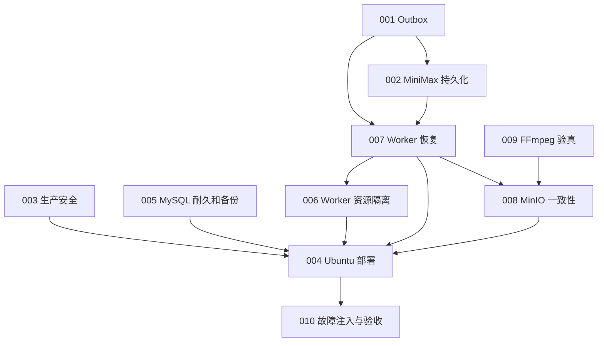

# Issue 依赖图

箭头从前置 Issue 指向后续验收 Issue。

- **无硬依赖**：003、005、001、009。001 的任何生产迁移都以 005 的备份恢复证据为上线门禁。
- **001 → 002 → 007**：持久事件身份先确定。恢复时需要区分未派发、已派发、上游请求未知和已知上游 ID。
- **007 → 006、008**：阶段切换和对象上传重放共享持久所有权。008 的最终成功条件还需要 009 的媒体校验。
- **003、005、006、007、008 → 004 → 010**：生产部署验收汇总安全、数据库、Worker、资源和存储前置条件。010 下的目标测试可在相应 Issue 内提前运行。

批次只是管理顺序。009 与 008 可并行设计；009 的校验输出先固定，008 才能完成成功条件验收。
