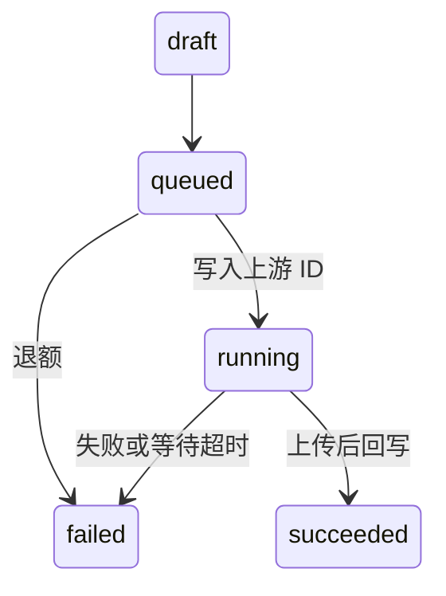
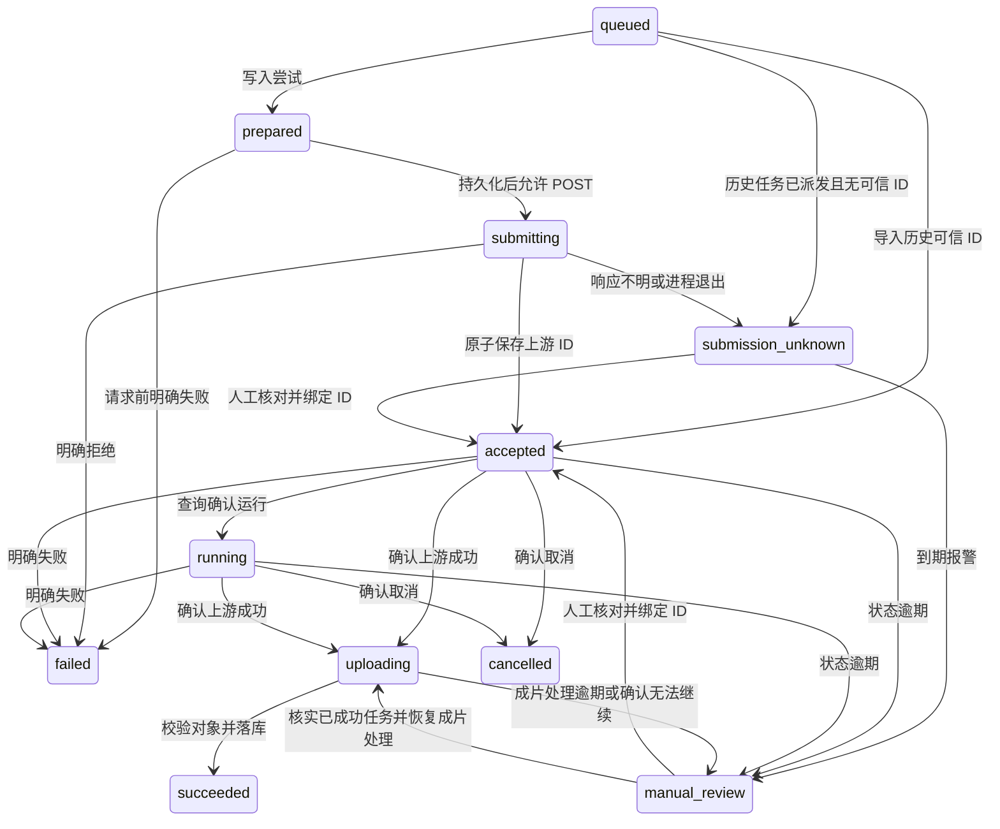

# 状态机

## 改造前的 Work 状态

## 改造后的内部状态

| 尝试状态 | 再次 POST | 退额 | 恢复动作 |
| --- | --- | --- | --- |
| `prepared` | 首次 POST 前须提交 `submitting` | 需先记录明确失败 | 接管后继续准备 |
| `submitting` | 否 | 否 | 能写入明确结果时正常推进，执行中断则进入未知 |
| `submission_unknown` | 否 | 否 | 按时间进入人工核对，或在已查证归属后补录 ID |
| `accepted`、`running` | 否 | 否 | 查询已有 ID，单片超时后继续恢复，状态长期未推进时人工核对 |
| `uploading` | 否 | 否 | 复用通过 SHA-256 和长度校验的对象，或查询原任务并重新处理 |
| `manual_review` | 否 | 否 | 运营人员核实供应商任务归属和状态 |
| `failed` | 可重试的明确失败且预算未用完时，新建尝试 | 终结失败时退一次 | 先检查重试条件，再决定补偿 |
| `cancelled` | 否 | 确认取消后退一次 | 按明确终态结算 |
| `succeeded` | 否 | 否 | Work 与尝试已原子成功，重复消息退出 |

公开 Work 仍使用 `draft/queued/running/succeeded/failed`。内部上传和人工核对使用对外 `running`。过期租约仅允许新执行世代接管。旧世代无法更新进度、上传检查点、终态或发起退款。
