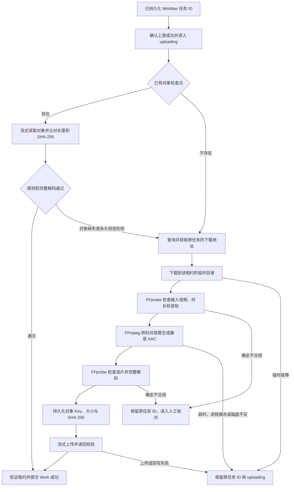

# 媒体流水线

新尝试的首帧准备也使用世代目录和可终止的 FFmpeg。预先持久化对象元数据，上传中断后存在可核对凭证。旧检查点在入库前重新做媒体验真。数据库写入仍经过第二阶段的 Work 行锁和 owner/generation 检查。

临时目录为 `I2V_MEDIA_TMP_DIR/w<work>-a<attempt>-g<generation>-<uuid>`，默认位于操作系统临时目录下的 `i2v-media`。活跃执行持有目录锁。正常退出先等待工具结束，再清理本目录。崩溃残留超过两小时后，由恢复 Worker 检查数据库世代、租期和文件锁再回收。该过程不会清理对象存储。

持久化尝试和恢复筛选使用 MySQL UTC。下载、转码、探测和解码的进程内截止用单调时钟。孤儿目录先按本机文件时间筛选，再以 MySQL 租约和本机文件锁确认。

[验真规范](MEDIA_VALIDATION_SPEC.md) · [部署说明](DEPLOYMENT_NOTES.md)
